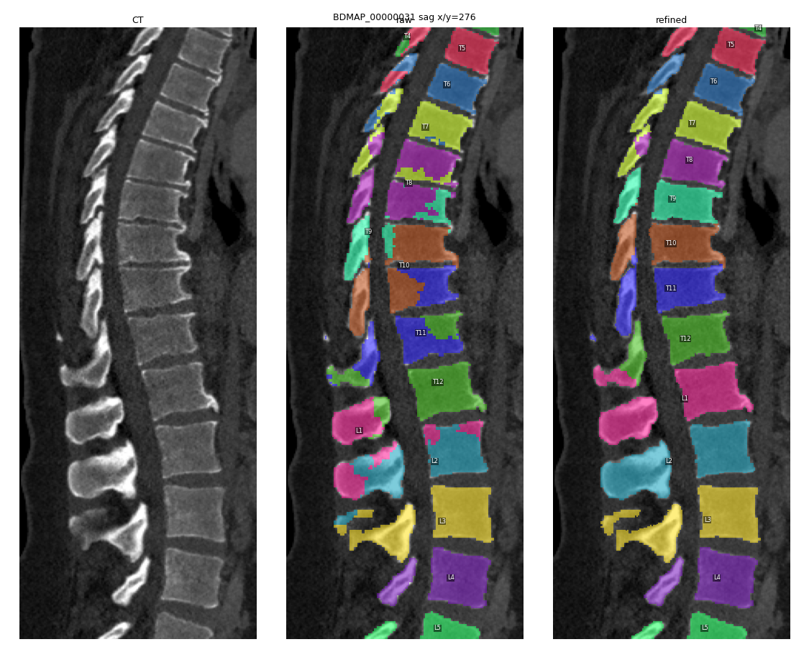

# ShapeKit-DAVIR

**DAVIR: Disc-Aware Vertebral Instance Recovery and Re-identification**

AI models segment the spine in CT quite well, but they often get the vertebra *names* wrong. A
typical case: the L1 body is labelled T12, T12 is labelled T11, and the whole run is off by one
level. DAVIR is a post-processing step that fixes this without retraining anything. It finds the
vertebral bodies from the discs between them, names them together so that C1 to L5 are always in
order, and only touches the labels that disagree. Everything that was already right stays as it was.


*BDMAP_00000031 (AbdomenAtlasDemo): CT, SuPreM prediction, and after DAVIR.*

On the two AbdomenAtlasDemo cases of the [BodyMaps](https://github.com/MrGiovanni/SuPreM/blob/main/direct_inference/vertebrae.md)
vertebrae warm-up, the refined SuPreM predictions reached a **mean DSC of 92.6%** in the BodyMaps evaluation.

DAVIR is also available inside [ShapeKit](https://github.com/BodyMaps/ShapeKit) as the
`shapekit_davir` vertebrae engine.

## Install

```bash
git clone https://github.com/Nikhil-Rao20/ShapeKit-DAVIR.git
cd ShapeKit-DAVIR
pip install -r requirements.txt
```

## Use

Your predictions should look like SuPreM's output, one folder per case:

```
predictions/
└── BDMAP_00000031/
    ├── combined_labels.nii.gz        # 1 = L5 ... 5 = L1, 6 = T12 ... 17 = T1, 18 = C7 ... 24 = C1
    └── segmentations/vertebrae_*.nii.gz
```

(`combined_labels.nii.gz` is enough; if it is missing, the per-vertebra files are used.)

```bash
python davir.py --pred_dir predictions --ct_dir ct_cases --out_dir refined
```

`ct_cases/<case>/ct.nii.gz` is optional but recommended: with the CT, thin discs are found more
reliably and the mask surface is tidied. The output has the same layout and grid as the input, with
all 24 vertebra files written. Add `--qc_dir qc` to get a small JSON per case saying what was changed.

From Python:

```python
import davir
refined = davir.refine(labels, affine, ct)   # labels: 1 = L5 ... 24 = C1, ct may be None
```

With ShapeKit:

```bash
python -W ignore main.py --input_folder $INPUT --output_folder $OUTPUT --log_folder $LOG \
    --vertebrae_engine shapekit_davir --ct_root /path/to/ct/cases --vertebrae_only
```

## How it works

1. **Clean the column.** Pieces far away from the spine are removed as false positives.
2. **Find the discs.** A line is traced through the vertebral bodies. Along it, discs show up as
   gaps in the predicted bone, as dips in CT intensity, and as places where the model changes its
   label. A spacing prior (normal vertebra heights) keeps the real discs and rejects label changes
   that happen in the middle of a bone.
3. **Name all vertebrae together.** Each body between two discs is one vertebra. A dynamic
   programme assigns the names in one go, using the model's own votes, so the order is always
   consistent.
4. **Change as little as possible.** A predicted label that matches one vertebra is kept and only
   renamed. Labels that span two vertebrae are re-assigned: bodies are cut at the discs, and each
   vertebral arch goes with the body it is attached to.
5. **Tidy up.** Stray pieces join the vertebra they touch, holes are filled, and the CT corrects
   the surface by one voxel.

If too few vertebrae are visible to do this safely, DAVIR only does the clean-up and keeps the
model's names.

## Reproducing the warm-up

1. Run SuPreM as described in its [vertebrae guide](https://github.com/MrGiovanni/SuPreM/blob/main/direct_inference/vertebrae.md).
   On recent GPUs (e.g. Blackwell) use a current PyTorch and MONAI; in
   `dataset/dataloader_test.py` replace `AddChanneld` with `EnsureChannelFirstd(..., channel_dim="no_channel")`
   and drop the final `ToTensord`, otherwise inference cannot restore the original grid.
2. `python davir.py --pred_dir AbdomenAtlasDemoPredict_raw --ct_dir AbdomenAtlasDemo --out_dir AbdomenAtlasDemoPredict`

About 25 s and 2.5 min per case on a CPU.

## Tests

```bash
python -m pytest tests                       # synthetic spine, a few seconds
python tools/robustness_tests.py --gt <clean case> --ct <case>/ct.nii.gz   # shifts, merges, fragments, cropped scans
```

## Acknowledgements

Built for the BodyMaps program at Johns Hopkins University (Prof. Zongwei Zhou). The ideas draw on
ShapeKit, Meng et al. (CMIG 2023), VERIDAH/SPINEPS, TotalSpineSeg and the VerSe challenge; the
spacing statistics come from VerSe (Payer et al. 2020).

## License

Apache 2.0, see [LICENSE](LICENSE).
